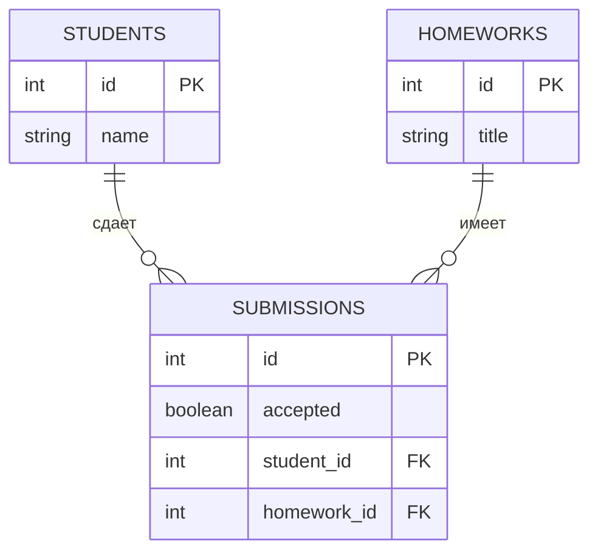

# Схема БД

Тема БД: учет домашних заданий студентов.



## Таблицы

`students` - студенты.

`homeworks` - домашние задания.

`submissions` - статус сдачи домашнего задания студентом.

## Связи

Один студент может иметь много сдач:

```text
students.id -> submissions.student_id
```

Одно домашнее задание может иметь много сдач:

```text
homeworks.id -> submissions.homework_id
```
