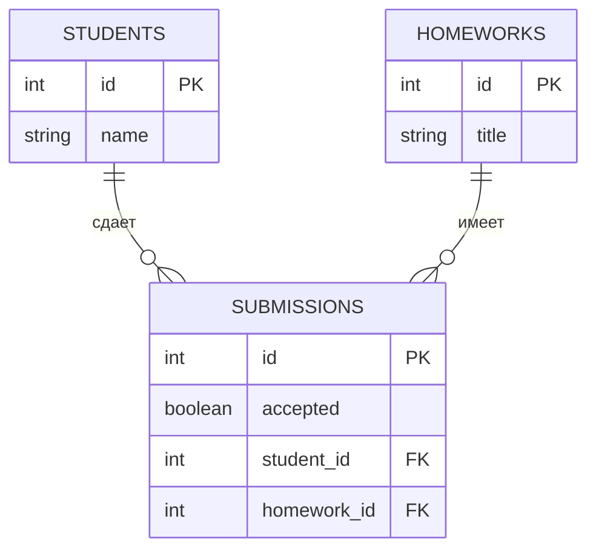

# Работа с БД // ДЗ

Лекция на 90 минут.

Тема учебной базы данных: учет домашних заданий студентов.

## Цели занятия

К концу занятия студенты должны понимать:

- зачем приложению нужна база данных;
- что такое БД и СУБД;
- что такое таблица, строка и столбец;
- что такое схема БД;
- что такое типы данных;
- что такое первичный и внешний ключ;
- как работают базовые CRUD-операции;
- как писать простые `SELECT`;
- за что отвечают коннекторы к БД;
- зачем нужен ORM;
- что такое SQLAlchemy, Session, `commit` и `session.scalars`.

## План на 90 минут

| Время | Тема |
| --- | --- |
| 0-10 мин | Зачем нужны базы данных |
| 10-20 мин | БД, СУБД, таблицы |
| 20-35 мин | Схема БД, типы данных, ключи |
| 35-50 мин | CRUD без ORM |
| 50-62 мин | Простые `SELECT` |
| 62-70 мин | Коннекторы к БД |
| 70-82 мин | SQLAlchemy, Session, commit |
| 82-90 мин | Один пример ORM |

## 1. Зачем приложению база данных

Приложение почти всегда работает с данными.

Например, учебная платформа хранит:

- студентов;
- домашние задания;
- статус сдачи домашнего задания.

На маленьком уровне данные можно хранить в файле.

Например:

```text
Анна Петрова сдала SQL SELECT
```

Но быстро появляются проблемы:

- нужно найти все задания студента;
- нужно понять, принято задание или нет;
- нужно обновить статус одной сдачи;
- нужно связать студента и домашнее задание;
- нужно не потерять данные при ошибке.

База данных хранит данные структурно: в таблицах, со связями и правилами.

## 2. База данных и СУБД

База данных - это организованное хранилище данных.

СУБД - система управления базами данных.

СУБД умеет:

- создавать таблицы;
- сохранять строки;
- искать строки;
- обновлять строки;
- удалять строки;
- проверять ограничения;
- фиксировать изменения через транзакции.

Примеры СУБД:

- SQLite;
- PostgreSQL;
- MySQL;
- MariaDB;
- MS SQL Server.

Для занятия используется SQLite.

SQLite удобна для обучения:

- не требует отдельного сервера;
- база хранится в одном `.db`-файле;
- можно быстро запускать примеры;
- SQL похож на SQL в других реляционных БД.

## 3. Что такое таблица

В реляционной БД данные хранятся в таблицах.

Таблица похожа на лист Excel:

- у таблицы есть имя;
- у таблицы есть столбцы;
- у таблицы есть строки.

Пример таблицы `students`:

| id | name |
| --- | --- |
| 1 | Анна Петрова |
| 2 | Борис Смирнов |

В этой таблице:

- `students` - имя таблицы;
- `id`, `name` - столбцы;
- строка с Анной - одна запись;
- строка с Борисом - другая запись.

Одна таблица обычно хранит один тип данных.

В нашей схеме:

- `students` хранит студентов;
- `homeworks` хранит домашние задания;
- `submissions` хранит факт сдачи и статус.

Плохо хранить все в одной таблице:

| student_name | homework_title | accepted |
| --- | --- | --- |
| Анна Петрова | SQL SELECT | True |

Почему это хуже:

- имя студента будет повторяться много раз;
- название задания будет повторяться много раз;
- сложнее обновлять данные;
- легко получить дубли.

Поэтому данные разделяют на таблицы и связывают ключами.

## 4. Новая схема БД

Схема БД - это план базы данных.

В схеме видно:

- какие таблицы есть;
- какие поля есть в таблицах;
- где первичные ключи;
- где внешние ключи;
- как таблицы связаны.

Для занятия используем три таблицы:



Связи:

```text
students.id -> submissions.student_id
homeworks.id -> submissions.homework_id
```

Это значит:

- одна сдача относится к одному студенту;
- одна сдача относится к одному домашнему заданию;
- один студент может иметь много сдач;
- одно домашнее задание может иметь много сдач.

Таблица `submissions` нужна как связь между студентом и домашним заданием.

Она отвечает на вопрос:

```text
какой студент сдал какое домашнее задание, и принято оно или нет
```

## 5. Типы данных

Тип данных отвечает на вопрос: какие значения можно хранить в столбце.

В нашей схеме используются простые типы:

| Тип | Что хранит | Пример |
| --- | --- | --- |
| `INTEGER` | целые числа | `id`, `student_id` |
| `TEXT` | текст | `name`, `title` |
| `BOOLEAN` | да/нет | `accepted` |

Для поля `accepted` используем:

```text
False - домашнее задание не принято
True - домашнее задание принято
```

## 6. Первичный ключ

Первичный ключ, или `primary key`, - это уникальный идентификатор строки.

Обычно это поле `id`.

Пример:

| id | name |
| --- | --- |
| 1 | Анна Петрова |
| 2 | Борис Смирнов |

Зачем нужен `id`:

- быстро найти строку;
- отличить одну строку от другой;
- связать таблицы между собой;
- не зависеть от имени.

В SQLite первичный ключ часто создают так:

```sql
id INTEGER PRIMARY KEY AUTOINCREMENT
```

Это значит:

- `id` хранит целое число;
- `id` является первичным ключом;
- SQLite сама выдаст следующий номер.

## 7. Внешний ключ

Внешний ключ, или `foreign key`, - это ссылка на строку в другой таблице.

В таблице `submissions` есть два внешних ключа:

```text
student_id -> students.id
homework_id -> homeworks.id
```

Это значит:

- `student_id` указывает, какой студент сделал сдачу;
- `homework_id` указывает, какое домашнее задание сдали.

Без внешних ключей таблицы были бы просто отдельными списками.

С внешними ключами получается связанная схема.

## 8. Создание таблиц без ORM

На самом начальном уровне можно работать с БД через стандартную библиотеку `sqlite3`.

Здесь нет функций и нет моделей.

Код идет сверху вниз:

1. подключились к БД;
2. создали cursor;
3. выполнили SQL;
4. сделали `commit`;
5. закрыли подключение.

Пример создания всех таблиц:

```python
import sqlite3

connection = sqlite3.connect("homework_tracker.db")
cursor = connection.cursor()

cursor.execute("PRAGMA foreign_keys = ON")

cursor.execute("""
CREATE TABLE IF NOT EXISTS students (
    id INTEGER PRIMARY KEY AUTOINCREMENT,
    name TEXT NOT NULL
)
""")

cursor.execute("""
CREATE TABLE IF NOT EXISTS homeworks (
    id INTEGER PRIMARY KEY AUTOINCREMENT,
    title TEXT NOT NULL
)
""")

cursor.execute("""
CREATE TABLE IF NOT EXISTS submissions (
    id INTEGER PRIMARY KEY AUTOINCREMENT,
    accepted BOOLEAN NOT NULL DEFAULT False,
    student_id INTEGER NOT NULL,
    homework_id INTEGER NOT NULL,
    FOREIGN KEY (student_id) REFERENCES students(id),
    FOREIGN KEY (homework_id) REFERENCES homeworks(id),
    CHECK (accepted IN (False, True))
)
""")

connection.commit()
connection.close()
```

## 9. Разница между BOOLEAN DEFAULT и CHECK

В таблице `submissions` есть две важные строки:

```sql
accepted BOOLEAN NOT NULL DEFAULT False
```

и:

```sql
CHECK (accepted IN (False, True))
```

Они делают разную работу.

`accepted BOOLEAN NOT NULL DEFAULT False` описывает сам столбец:

- имя столбца: `accepted`;
- тип данных: `BOOLEAN`;
- значение обязательно: `NOT NULL`;
- если значение не передали, ставится `False`.

Пример:

```sql
INSERT INTO submissions (student_id, homework_id)
VALUES (1, 1);
```

В этом случае `accepted` станет `False`, потому что есть `DEFAULT False`.

В SQLite важно помнить: `False` обычно хранится как `0`, а `True` как `1`.

Для учебного кода мы пишем `False` и `True`, потому что так понятнее читать Python-код.

`CHECK (accepted IN (False, True))` проверяет допустимые значения.

Он говорит:

```text
в accepted можно записать только False или True
```

Пример:

```sql
INSERT INTO submissions (student_id, homework_id, accepted)
VALUES (1, 1, 'maybe');
```

Такое значение не подходит под правило `CHECK`.

Коротко:

| Строка | За что отвечает |
| --- | --- |
| `accepted BOOLEAN NOT NULL DEFAULT False` | создает обязательное булево поле и задает значение по умолчанию |
| `CHECK (accepted IN (False, True))` | запрещает значения вне `False` и `True` |

## 10. CRUD

CRUD - это четыре базовые операции с данными:

| Буква | Операция | Что делает |
| --- | --- | --- |
| C | Create | создает запись |
| R | Read | читает запись |
| U | Update | обновляет запись |
| D | Delete | удаляет запись |

Для учета домашних заданий:

- Create: добавить студента, домашнее задание и сдачу;
- Read: посмотреть список сдач;
- Update: отметить сдачу как принятую;
- Delete: удалить сдачу.

## 11. CREATE

`CREATE` в CRUD означает создание записи.

В SQL для этого используют `INSERT`.

Пример:

```python
import sqlite3

connection = sqlite3.connect("homework_tracker.db")
cursor = connection.cursor()

cursor.execute(
    "INSERT INTO students (name) VALUES (?)",
    ("Анна Петрова",),
)
student_id = cursor.lastrowid

cursor.execute(
    "INSERT INTO homeworks (title) VALUES (?)",
    ("SQL SELECT",),
)
homework_id = cursor.lastrowid

cursor.execute(
    "INSERT INTO submissions (student_id, homework_id, accepted) VALUES (?, ?, ?)",
    (student_id, homework_id, False),
)

connection.commit()
connection.close()
```

Знак `?` - это placeholder.

Значения передаются отдельно:

```python
("Анна Петрова",)
```

Так безопаснее, чем склеивать SQL-строку вручную.

## 12. READ

`READ` означает чтение данных.

В SQL для этого используют `SELECT`.

Пример чтения всех сдач:

```python
import sqlite3

connection = sqlite3.connect("homework_tracker.db")
cursor = connection.cursor()

cursor.execute("""
SELECT students.name, homeworks.title, submissions.accepted
FROM submissions
JOIN students ON students.id = submissions.student_id
JOIN homeworks ON homeworks.id = submissions.homework_id
""")

rows = cursor.fetchall()

for row in rows:
    student_name = row[0]
    homework_title = row[1]
    accepted = bool(row[2])

    print(student_name, homework_title, accepted)

connection.close()
```

`fetchall()` возвращает все строки результата.

## 13. UPDATE

`UPDATE` означает изменение данных.

Например, нужно отметить сдачу как принятую.

```python
import sqlite3

connection = sqlite3.connect("homework_tracker.db")
cursor = connection.cursor()

cursor.execute(
    "UPDATE submissions SET accepted = ? WHERE id = ?",
    (True, 1),
)

connection.commit()
connection.close()
```

Здесь:

- `accepted = True` значит "принято";
- `WHERE id = 1` говорит, какую строку менять.

Без `WHERE` можно случайно обновить все строки.

## 14. DELETE

`DELETE` означает удаление данных.

Пример:

```python
import sqlite3

connection = sqlite3.connect("homework_tracker.db")
cursor = connection.cursor()

cursor.execute("DELETE FROM submissions WHERE id = ?", (1,))

connection.commit()
connection.close()
```

`WHERE` здесь очень важен.

Без `WHERE` можно удалить все строки.

## 15. SELECT подробнее

`SELECT` - главный запрос для чтения данных.

### Все строки

```sql
SELECT id, name
FROM students;
```

### WHERE

`WHERE` фильтрует строки.

```sql
SELECT id, name
FROM students
WHERE name = 'Анна Петрова';
```

В Python:

```python
cursor.execute(
    "SELECT id, name FROM students WHERE name = ?",
    ("Анна Петрова",),
)
print(cursor.fetchall())
```

### ORDER BY

`ORDER BY` сортирует строки.

```sql
SELECT id, title
FROM homeworks
ORDER BY title;
```

### JOIN

`JOIN` соединяет таблицы.

Например, нужно вывести имя студента, домашнее задание и статус.

```sql
SELECT students.name, homeworks.title, submissions.accepted
FROM submissions
JOIN students ON students.id = submissions.student_id
JOIN homeworks ON homeworks.id = submissions.homework_id;
```

### COUNT

`COUNT` считает строки.

```sql
SELECT COUNT(*)
FROM submissions;
```

Можно посчитать только непринятые сдачи:

```sql
SELECT COUNT(*)
FROM submissions
WHERE accepted = False;
```

## 16. Транзакция и commit

Транзакция - это группа изменений, которая должна сохраниться целиком.

Простой пример:

1. добавили студента;
2. добавили домашнее задание;
3. добавили сдачу.

Если все прошло успешно, вызываем:

```python
connection.commit()
```

`commit` фиксирует изменения в БД.

Если `commit` не вызвать, изменения могут не сохраниться.

Для чтения `SELECT` обычно `commit` не нужен, потому что данные не меняются.

## 17. Коннекторы к БД

Коннектор к БД - это библиотека, через которую Python подключается к конкретной базе данных.

Коннектор отвечает за низкоуровневую работу:

- открыть подключение;
- отправить SQL-запрос;
- передать параметры в запрос;
- получить строки результата;
- сообщить об ошибке;
- закрыть подключение.

Примеры:

- `sqlite3` - коннектор для SQLite, входит в стандартную библиотеку Python;
- `psycopg` - коннектор для PostgreSQL;
- `mysqlclient` - коннектор для MySQL;
- `pyodbc` - коннектор для баз через ODBC;
- `asyncpg` - асинхронный коннектор для PostgreSQL.

На занятии в простых примерах используется `sqlite3`.

Пример работы коннектора:

```python
import sqlite3

connection = sqlite3.connect("homework_tracker.db")
cursor = connection.cursor()
cursor.execute("SELECT id, name FROM students")
rows = cursor.fetchall()
connection.close()
```

## 18. Что такое SQLAlchemy

SQLAlchemy - это библиотека Python для работы с базами данных.

Она умеет работать на двух уровнях:

- SQLAlchemy Core;
- SQLAlchemy ORM.

SQLAlchemy ORM позволяет работать с таблицами через Python-классы.

Без ORM мы пишем SQL:

```python
cursor.execute(
    "INSERT INTO students (name) VALUES (?)",
    ("Анна Петрова",),
)
```

С ORM мы создаем объект:

```python
student = Student(name="Анна Петрова")
session.add(student)
session.commit()
```

Идея:

```text
Python-объект -> ORM -> SQL-запрос -> база данных
```

## 19. Session

`Session` - это объект SQLAlchemy ORM для работы с БД.

Через session обычно делают:

- добавление объектов;
- чтение объектов;
- изменение объектов;
- удаление объектов;
- `commit`.

Пример:

```python
session.add(student)
session.commit()
```

Если изменить объект:

```python
submission.accepted = True
session.commit()
```

SQLAlchemy сам поймет, что нужен SQL `UPDATE`.

## 20. session.scalars

`session.scalars(...)` используют, когда запрос должен вернуть ORM-объекты или одно значение из каждой строки.

В обычном `SELECT` база данных возвращает строки.

А ORM должен вернуть Python-объекты.

Например, если мы пишем:

```python
select(Student)
```

мы хотим получить объекты `Student`, а не технические строки результата.

Пример:

```python
query = select(Student)
students = session.scalars(query).all()
```

`session.scalars(query).all()` означает:

```text
выполнить запрос и вернуть список объектов Student
```

Слово `scalars` можно читать как:

```text
верни главное значение из каждой строки результата
```

Если запрос выбирает модель `Student`, главным значением будет объект `Student`.

Если запрос выбирает одну колонку, например `Student.name`, главным значением будет имя студента.

Для начала проще запомнить так:

- `session.scalars(select(Student)).all()` - список объектов `Student`;
- `session.execute(...)` - строки с несколькими колонками.

## 21. Что такое ORM

ORM - Object-Relational Mapping.

Простыми словами:

```text
ORM связывает Python-классы и таблицы в БД
```

Класс описывает таблицу.

Объект класса описывает строку.

Например:

```text
class Student -> таблица students
student = Student(...) -> одна строка в students
```

ORM помогает меньше писать SQL руками.

Но перед ORM важно понять обычные таблицы, ключи и SQL.

## 22. ORM-пример с models.py

Модели лежат в отдельном файле `models.py`.

Пример импортирует их и показывает:

- подключение;
- создание таблиц;
- создание данных;
- чтение;
- обновление;
- удаление.

```python
from sqlalchemy import create_engine, select
from sqlalchemy.orm import sessionmaker

from models import Base, Homework, Student, Submission

engine = create_engine("sqlite:///orm_homework_tracker.db")
Base.metadata.create_all(engine)

Session = sessionmaker(bind=engine)
session = Session()

student = Student(name="Анна Петрова")
homework = Homework(title="SQLAlchemy ORM")
submission = Submission(student=student, homework=homework, accepted=False)

session.add(student)
session.add(homework)
session.add(submission)
session.commit()

query = select(Submission)
submissions = session.scalars(query).all()

for item in submissions:
    print(item.student.name, item.homework.title, item.accepted)

submission.accepted = True
session.commit()

session.delete(submission)
session.commit()

session.close()
```
